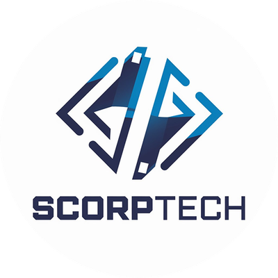

<p align="center"></p>

# ScorpTech x402 MCP Server

**1,012 x402 pay-per-call tools: web data, security/OSINT, SEC/public data, Solana/EVM lookups, developer utilities.**
Pay per call in USDC on **Solana or Base** via the [x402](https://x402.org) protocol. Most tools cost **$0.001**; none cost more than $0.03.
No signup, no API key, no subscription.

This repository is the public listing for the hosted ScorpTech x402 MCP server. It runs as a remote
Streamable HTTP server operated by [ScorpTech](https://scorptech.it.com), so there's nothing to install or self-host.

## Endpoints

All servers use Streamable HTTP (POST) and are stateless. `tools/list` is always free.

| Server | URL | Tools |
|---|---|---|
| **Lite** (recommended for Claude, Cursor, etc.) | `https://scorptech.it.com/api/x402/mcp/lite` | 2: `search_tools` (free) + `call_tool` (reaches all 1,012) |
| Security, OSINT, DNS and email | `https://scorptech.it.com/api/x402/mcp/security` | 68 |
| Web data, scraping, SEO and text | `https://scorptech.it.com/api/x402/mcp/web` | 31 |
| SEC filings, finance and public data | `https://scorptech.it.com/api/x402/mcp/sec` | 52 |
| Crypto and on-chain (Solana/EVM) | `https://scorptech.it.com/api/x402/mcp/crypto` | 43 |
| Developer utilities (JSON, CSV, regex, time) | `https://scorptech.it.com/api/x402/mcp/dev` | 50 |
| Everything | `https://scorptech.it.com/api/x402/mcp` | 1,012 (about 1 MB list; supports `tools/list` cursor paging) |

| | |
|---|---|
| How to use and pay (guide) | https://scorptech.it.com/api/x402/docs |
| Full tool catalog | https://scorptech.it.com/api/x402/docs/all |
| OpenAPI | https://scorptech.it.com/api/x402/openapi.json |
| Health | https://scorptech.it.com/api/x402/health |
| Official MCP Registry | [`com.it.scorptech/x402`](https://registry.modelcontextprotocol.io/v0/servers?search=com.it.scorptech/x402) |

## Add it to your MCP client

```json
{
  "mcpServers": {
    "scorptech-x402": {
      "type": "http",
      "url": "https://scorptech.it.com/api/x402/mcp/lite"
    }
  }
}
```

Use any of the themed URLs above instead of `/mcp/lite` if you only need one area. The same config is in [`.mcp.json`](.mcp.json).
For stdio-only clients, use a bridge such as [`mcp-remote`](https://www.npmjs.com/package/mcp-remote):
`npx -y mcp-remote https://scorptech.it.com/api/x402/mcp/lite`.

## How paying works

1. Call a tool. If the call carries no payment, you get the x402 `PaymentRequired` object: price, asset (USDC), network and recipient.
2. Your x402 client signs an exact USDC payment. You don't need SOL or ETH for fees, because the facilitator pays them.
3. Retry with the payment. You get the result plus a settlement receipt. **If the tool fails, you're not charged.**

| Network | CAIP-2 | Asset | Pay to |
|---|---|---|---|
| Solana (listed first) | `solana:5eykt4UsFv8P8NJdTREpY1vzqKqZKvdp` | USDC `EPjFWdd5AufqSSqeM2qN1xzybapC8G4wEGGkZwyTDt1v` | `Gzn6fbrn11cd61iH4mgQvtmf4PHmeMCRn8msU4hjpty8` |
| Base | `eip155:8453` | USDC `0x833589fCD6eDb6E08f4c7C32D4f71b54bdA02913` | `0xBC72c556166A3d3317c673DDB21Fb088C10088A0` |

Facilitator: [PayAI](https://facilitator.payai.network). For MCP, the payment goes in `params._meta["x402/payment"]` (x402 v2 MCP transport).

### Example (Node, @x402/fetch over plain HTTPS)

```ts
import { wrapFetchWithPaymentFromConfig } from "@x402/fetch";
import { ExactEvmScheme } from "@x402/evm";
import { privateKeyToAccount } from "viem/accounts";

const pay = wrapFetchWithPaymentFromConfig(fetch, {
  schemes: [{ network: "eip155:8453", client: new ExactEvmScheme(privateKeyToAccount(process.env.EVM_KEY)) }],
});
const res = await pay("https://scorptech.it.com/api/x402/v1/headers-audit?url=https://example.com");
console.log(await res.json());
```

### Example (MCP client, @x402/mcp)

```ts
import { createx402MCPClient } from "@x402/mcp";
import { ExactEvmScheme } from "@x402/evm";
import { StreamableHTTPClientTransport } from "@modelcontextprotocol/sdk/client/streamableHttp.js";

const client = createx402MCPClient({ name: "my-agent", version: "1.0.0", autoPayment: true,
  schemes: [{ network: "eip155:8453", client: new ExactEvmScheme(account) }] });
await client.connect(new StreamableHTTPClientTransport(new URL("https://scorptech.it.com/api/x402/mcp/security")));
const r = await client.callTool("headers_audit", { url: "https://example.com" });
```

The 402 response carries the x402 v2 `PAYMENT-REQUIRED` header, and its JSON body is v1-compatible (`x402Version: 1`, `accepts[]`), so both current and older x402 clients (`x402-fetch`, `x402-axios`, Python `x402`) can pay.

## Prices

| Price per call | Tools |
|---|---|
| $0.001 | 806 |
| $0.002 | 54 |
| $0.003 | 34 |
| $0.004 to $0.008 | 61 |
| $0.01 | 49 |
| $0.02 to $0.03 | 8 |

## Links

- Website: https://scorptech.it.com
- Guide: https://scorptech.it.com/api/x402/docs
- MCP Registry entry: `com.it.scorptech/x402`
- x402 protocol: https://x402.org

## Author

ScorpTech / Kaleb Holley · https://scorptech.it.com
